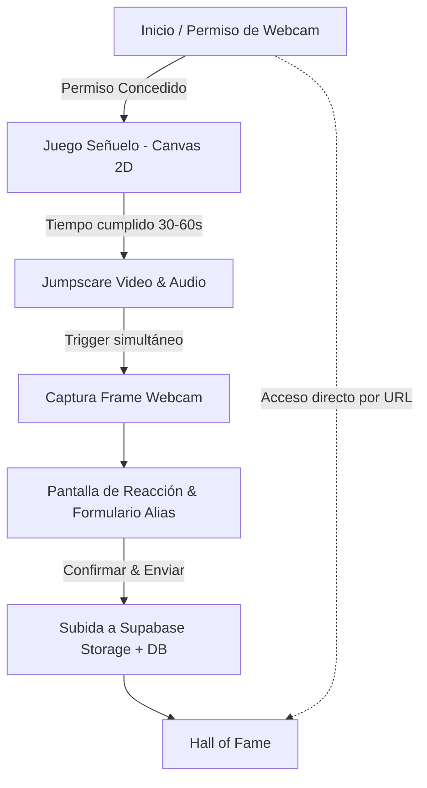

# Software Architecture - DAWlloween

## 1. Executive Summary & Purpose

**DAWlloween** es una aplicación web interactiva (SPA) diseñada para la celebración de Halloween en el centro educativo por parte de los alumnos de 1º y 2º de DAW. Combina un minijuego señuelo rápido tipo *survival* (Canvas 2D), un evento de susto multimedia (jumpscare) con captura simultánea de la webcam, y un *Hall of Fame* público persistido en la nube para que los alumnos y visitantes puedan rememorar las reacciones tanto en el aula como desde sus casas.

---

## 2. Technology Stack

| Layer | Technology | Rationale |
|---|---|---|
| **Frontend Core** | Vanilla JavaScript (ES Modules), HTML5 Canvas, Vanilla CSS | Sin dependencias pesadas, arranque instantáneo, máximo rendimiento y control directo sobre el bucle gráfico (`requestAnimationFrame`) y la webcam (`getUserMedia`). |
| **Arquitectura Web** | Single Page Application (SPA) | Navegación fluida por estados/vistas sin recargas completas de página (`#game`, `#hall-of-fame`, etc.). |
| **Backend as a Service (BaaS)** | **Supabase** (PostgreSQL + Object Storage) | Capa gratuita (Free Tier), SDK cliente en JS (`@supabase/supabase-js`), almacenamiento de imágenes (JPG/WebP) y base de datos relacional para los registros de participantes. |
| **Seguridad / Políticas** | Row Level Security (RLS) en Supabase | Inserción pública anónima de fotos y nombres desde el juego; lectura pública de la galería; eliminación restringida. |
| **Despliegue & Hosting** | **Vercel** / **GitHub Pages** (Static Cloud Hosting) | HTTPS obligatorio para acceso a la API de cámara web, despliegue continuo y alta disponibilidad para ser visitado desde casa. |
| **Resiliencia ante Red** | Reintentos con alertas visuales | Si hay microcortes o problemas de conexión con Supabase, la app reintenta la operación periódicamente y muestra alertas visuales en pantalla, sin guardar nada en local. |

---

## 3. SPA State & View Model

La aplicación opera bajo un patrón de máquina de estados en el cliente:



### Vistas de la SPA:
1. **Welcome / Calibration (`#home`)**: Explicación lúdica de la actividad y solicitud de permisos para el uso de la cámara.
2. **Game View (`#play`)**: Renderizado en `<canvas>` del minijuego 2D señuelo.
3. **Screamer & Freeze (`#screamer`)**: Superposición de vídeo/sonido del susto y captura del fotograma en un `<canvas>` oculto.
4. **Reaction Preview & Register (`#register`)**: Muestra la foto capturada al jugador y le permite ingresar su nombre/alias.
5. **Hall of Fame (`#hall-of-fame`)**: Muro/mosaico de fotos con nombres y fecha, optimizado para proyectarse en pantalla completa y accesible directamente vía enlace para verlo desde casa.

---

## 4. Cloud Integration (Supabase BaaS)

Al utilizar Supabase como BaaS, la SPA se conecta directamente mediante la clave anónima (`anon key` pública):
1. **Supabase Storage (`bucket: reactions`)**:
   - Guarda las imágenes capturadas (en formato `.webp` o `.jpg` comprimido, ~100-200 KB por imagen).
   - Genera una URL pública de la imagen.
2. **Supabase Database (`table: hall_of_fame`)**:
   - Estructura:
     - `id`: UUID (Primary Key, auto-generado)
     - `nickname`: TEXT (Nombre o apodo introducido)
     - `photo_url`: TEXT (Enlace a la foto en Storage)
     - `created_at`: TIMESTAMPTZ (Fecha y hora)
   - Política RLS:
     - `SELECT`: Público (cualquiera puede ver el Hall of Fame).
     - `INSERT`: Público con clave anónima (cualquiera que complete el juego puede registrar su reacción).
     - `UPDATE / DELETE`: Deshabilitado anónimamente para evitar vandalismo.

---

## 5. Repository & Directory Structure

```text
DAWlloween/
├── docs/                      # Documentación del proyecto (Roadmap, Arquitectura)
├── specs/                     # Especificaciones funcionales y tareas SDD
├── public/                    # Activos estáticos (vídeo susto, audios, iconos, sprites)
│   ├── assets/
│   │   ├── screams/           # Vídeo/audio del jumpscare
│   │   └── sprites/           # Gráficos del minijuego
├── src/
│   ├── app.js                 # Router SPA y orquestador principal
│   ├── config.js              # Configuración de entorno / Supabase credentials
│   ├── game/                  # Lógica del minijuego Canvas 2D
│   │   ├── engine.js          # Gameloop (requestAnimationFrame), entrada y colisiones
│   │   └── entities.js        # Jugador y enemigos
│   ├── screamer/              # Módulo de susto y captura
│   │   ├── camera.js          # Acceso a navigator.mediaDevices y captura de frame
│   │   └── jumpscare.js       # Reproducción de vídeo y sincronización de captura
│   ├── services/              # Capa de datos desacoplada
│   │   └── supabase.js        # Cliente y llamadas a Supabase Storage/DB con reintentos
│   └── ui/                    # Componentes visuales transversales
│       └── alerts.js          # Notificaciones / toast de red y avisos
│   └── views/                 # Renderizado de vistas SPA
│       ├── welcomeView.js
│       ├── registerView.js
│       └── hallOfFameView.js
├── styles/                    # Estilos CSS temáticos de Halloween
│   ├── main.css               # Variables CSS, tipografías y reset
│   ├── game.css               # Estilos del contenedor del juego y UI
│   └── hall-of-fame.css       # Estilos del mural de fotos
├── index.html                 # Punto de entrada SPA
└── package.json               # Configuración opcional para scripts / dependencias ligeras
```

---

## 6. Developer & Security Practices

- **Separación de capas**: La lógica del juego (`game/`), la captura/hardware (`screamer/`), los servicios de persistencia (`services/`) y las vistas (`views/`) están totalmente desacopladas mediante módulos ES6.
- **Patrones de diseño pedagógicos**: Aplicación de patrones de diseño reconocibles (State para SPA/juego, Pub-Sub/Event Bus para desacoplar eventos de susto/captura, Factory para entidades y Singleton/Módulo para servicios) para reforzar el aprendizaje de los alumnos de DAW.
- **Responsive Web Design & A11y**: 
  - La interfaz de juego se adapta a resoluciones de escritorio habituales (1080p, 720p, portátiles).
  - El *Hall of Fame* es totalmente responsive tanto para escritorio/proyección como para dispositivos móviles mediante Vanilla CSS (CSS Grid, Flexbox y media queries).
  - Cumplimiento de pautas de usabilidad y accesibilidad (semántica, contrastes cromáticos legibles en temática oscura y foco visible).
- **Rendimiento y compresión de imagen**: La captura de la cámara se comprime en el cliente a resolución adecuada (ej. 640x480 o 800x600 en formato WebP con calidad 0.8) antes de subir a la nube para garantizar subidas instantáneas incluso con ancho de banda reducido.
- **Resiliencia ante fallos de red**: Si falla la llamada a Supabase (offline o microcorte de red), la app captura el error, lanza alertas/notificaciones visuales en pantalla y reintenta automáticamente el envío, sin persistir nada en almacenamiento local.
- **Estándar de idioma en el código (UK English)**: Todos los nombres de variables, funciones, clases, constantes, comentarios y docstrings deben estar estrictamente en inglés británico (`en-GB`).

